 

**I build things to understand how they work.**
 
Rocketry · Physics · Astrophysics · Engineering · Scientific computing

 

## 🚀 Hi, I'm Kunj

I'm drawn to the parts of science you can test with your own hands: things that fly, orbit, burn, or measure the sky. It started when I watched India's Mars Orbiter Mission lift off and wanted to understand rockets, and the sky they fly into.

On any build, **I'm the aerodynamics and propulsion guy.**

## 🛰️ Mission record

| | |
|---|---|
| 🏗️ **Founder**, Indian Rocketry Association | 2022 |
| 🔥 **Prometheus**, IRA's first rocket, built with IIT Kanpur's RaSET (I worked on propulsion and aerodynamics) | 3,348 m · Mach 1.37 · 46 g |
| 🎖️ **Tripoli Level 2** certified | 2026 |
| 🌍 **NASA International Space Apps Challenge**, Global Nominee | 2021 · 2025 |
| 🥇 **CanSat Competition**, SVNIT Physics Club, first prize | 2026 |
| 🥈 **Apex Flight Rocketry Competition**, IIT Mandi, 2nd of 31 teams | 2026 |

## 🎓 Studying

- **Integrated M.Sc. in Physics**, SVNIT Surat (2025 to 2030)
- **BS in Aeronautics and Space Technology**, IIT Madras

## 🧰 Toolkit

## 🔭 Things you can poke at on my site

My [portfolio](https://kunjsorathiya.github.io) is a small universe of its own:

- 🌌 **[Gallery](https://kunjsorathiya.github.io/gallery/)**: fly to a space telescope, point and focus it, ride a capsule home through re-entry, then walk the Earth to my photographs
- 🌠 **[Sky tonight](https://kunjsorathiya.github.io/sky/)**: the sky above you, computed live in your browser
- 🗺️ **[Travels](https://kunjsorathiya.github.io/travels/)**: a spinning globe of the places behind the projects
- 🏅 **[Recognition](https://kunjsorathiya.github.io/recognition/)**: awards and certificates, pinned to a wall
- 🪂 **[A 404 you can play](https://kunjsorathiya.github.io/this-page-does-not-exist)**: bring a capsule down onto the pad

## 🐍 My contribution graph, eaten

*Keep looking up.*

